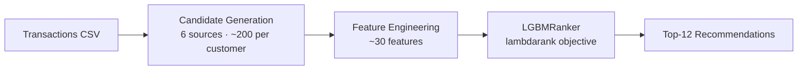

# H&M Personalised Fashion Recommendations — Two-Stage Recommender System

> **MAP@12 = 0.03157** (offline backtest on held-out week 2020-37)

A two-stage recommender system built on the [H&M Personalised Fashion Recommendations](https://www.kaggle.com/competitions/h-and-m-personalized-fashion-recommendations) dataset. Stage one generates a candidate pool of ~200 articles per customer from six complementary sources; stage two re-ranks that pool with a LightGBM Learning-to-Rank model trained on ~30 hand-crafted features. The evaluation is an offline backtest against a held-out week — not submitted to the Kaggle leaderboard — and the score is comparable to publicly documented silver-medal-tier solutions from the original competition.

## Pipeline



## Results

| Split | Week | Candidate recall | MAP@12 |
|-------|------|-----------------|--------|
| Validation | 2020-36 | 14.49% | 0.02790 |
| Test | 2020-37 | 15.81% | 0.03157 |

## Findings

- **Stage 1 is the bottleneck.** Candidate recall is 15.81% on test, so roughly 84% of purchased items never reach the ranker. The ranker can only reorder what stage 1 supplies, so improving candidate generation has more headroom than tuning the ranker.
- **Results are consistent across weeks, with some noise.** Validation (2020-36) scores MAP@12 0.02790 and test (2020-37) scores 0.03157. Both weeks show the same pattern, but the ~13% gap shows weekly variance is real.
- **Product category drives the ranker.** `department_name`, `colour_group_name` and `product_type_name` are the top features by split count, followed by customer recency (`cust_last_tx_days`) and `age`. Split count favours high-cardinality categoricals, so this ranking is indicative, not conclusive.

## Limitations

- Single hold-out week for test. I report validation alongside it, but have not computed confidence intervals across multiple weeks.
- The ranker is trained on one week of candidates, and hyperparameters come from a 4-point grid.
- This is an offline backtest, not a Kaggle leaderboard submission, so it is not directly comparable to leaderboard scores.
- Offline MAP@12 does not capture business metrics such as revenue, diversity or novelty.
- No baseline or ablation comparisons yet. These are the next step.

## How I Would Test This Online

- **Randomization:** by customer, using a stable hash so users stay in one variant.
- **Control vs treatment:** current ranking (e.g. bestsellers) vs this model's top-12.
- **Metrics:** primary is purchase conversion on recommended items. Guardrails are revenue per user, return rate and catalog coverage.
- **Sizing:** a power calculation on baseline conversion and the minimum effect worth shipping, run for full weeks to cover weekly seasonality.
- **Risks:** novelty effects, shared-inventory interference, and cold-start customers needing a separate analysis.
- **Offline-online gap:** offline MAP@12 favours repeat purchases, so I would trust the A/B result over the offline gain.

## Architecture

### Stage 1 — Candidate Generation

Six sources are generated from transaction history strictly before the target week (no leakage), then merged into a single DataFrame with one-hot source flags:

| Key | Source | Logic |
|-----|--------|-------|
| `s1_recent` | Recent bestsellers | Top-30 most-sold articles in the last 8 weeks, given to every buyer |
| `s2_seasonal` | Seasonal bestsellers | Top-30 from the same calendar weeks in the prior two years |
| `s3_repurchase` | Repurchase history | Each customer's 30 most-recently-bought distinct articles |
| `s4_i2i` | Item-to-item co-occurrence | Co-purchase graph (sparse matrix multiply); top-20 neighbours per article, seeded by each customer's 5 most-recent articles |
| `s5_idx` | Index-group bestsellers | Top-30 per `index_group_name` (Ladieswear, Menswear, …), mapped to each customer's favourite group |
| `s6_cf8` / `s6_cf52` | Collaborative filtering (ALS) | `implicit` ALS at 64 factors, trained on 8-week and 52-week windows; top-30 per customer via matrix multiply |

Sources are filtered to active buyers of the target week, then unioned. Duplicate `(customer_id, article_id)` pairs are collapsed; `n_sources` counts how many sources nominated each pair.

### Stage 2 — LGBMRanker

The candidate DataFrame is enriched with ~30 features and passed to `lgb.LGBMRanker` with `objective='lambdarank'`. Groups are the per-customer candidate counts (rows must be sorted by `customer_id` before fitting).

**Feature groups:**

- **Source flags**: `s1_recent` … `s6_cf52`, `n_sources`
- **Article-level**: `art_pop_all`, `art_pop_recent`, `art_mean_price`, `art_n_buyers_recent`, `art_last_sale_days`
- **Customer-level**: `cust_n_tx`, `cust_n_distinct_art`, `cust_mean_price`, `cust_max_price`, `cust_last_tx_days`
- **Customer × article**: `pair_buy_count`, `pair_last_days`, `bought_before`
- **Affinity**: `colour_share`, `index_share`, `price_diff`, `price_ratio`
- **Demographics**: `age`, `Active`, `FN`
- **Categoricals** (native LightGBM): `product_type_name`, `department_name`, `garment_group_name`, `colour_group_name`, `index_group_name`, `club_member_status`, `fashion_news_frequency`

**Top features by LightGBM split importance:**

| Feature | Importance |
|---------|-----------|
| `department_name` | 4790 |
| `colour_group_name` | 2960 |
| `product_type_name` | 2253 |
| `cust_last_tx_days` | 1703 |
| `age` | 1695 |

Hyperparameters are tuned over a 4-point grid on the validation week; the best config is retrained on the validation week before final test evaluation (single hold-out, no leakage).

## Project Structure

```
hm-recommendations/
├── data/
│   ├── articles.csv
│   ├── customers.csv
│   └── transactions_train.csv
├── notebooks/
│   ├── eda.ipynb
│   └── 02_modeling.ipynb
├── src/
│   ├── config.py        # paths and hyperparameter constants
│   ├── data_loader.py   # CSV loading and train/val/test split
│   ├── candidates.py    # all 6 candidate sources + merge
│   ├── features.py      # feature engineering + FEATURE_COLS
│   ├── model.py         # LGBMRanker, MAP@12, candidate recall
│   └── main.py          # end-to-end pipeline
├── requirements.txt
└── README.md
```

## How to Run

```bash
pip install -r requirements.txt
PYTHONPATH=. python src/main.py
```

The script trains on week 2020-35, tunes on 2020-36, then evaluates once on 2020-37. Expected runtime is 20–40 minutes on a modern laptop (the 52-week ALS window dominates).
